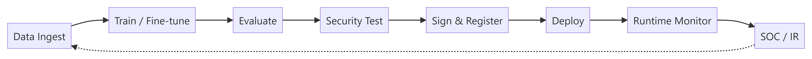

# MLSecOps Reference Model & Practical Guide

> **Open-source MLSecOps reference model and practical guide for AI security, LLM/RAG, agentic AI, and secure MLOps.**

[](CHANGELOG.md)
[](CHANGELOG.md)
[](https://doi.org/10.5281/zenodo.21206780)
[](https://mhaghighian.github.io/MLSecOps/)
[](LICENSE)
[](https://www.bestpractices.dev/projects/15668)
[](https://www.bestpractices.dev/projects/15668)

**MLSecOps Reference Model & Practical Guide** is an open-source reference model and engineering handbook for **AI security**, **machine learning security**, and **secure MLOps** across the full ML lifecycle — from data and training through deployment, runtime monitoring, SOC, and governance.

It defines an actionable **lifecycle control model (`CP 1–10`)**, machine-readable **Evidence Pack JSON Schema**, **OPA/Conftest Policy-as-Code** admission samples, and **Secure-by-Design** blueprints covering **LLM security**, **RAG security**, **agentic AI**, **MCP**, **AI supply chain security**, and **DevSecOps** patterns for production AI systems. Independent open-source reference model and guide — not a product manual or an official OWASP, NIST, or ISO standard.

**New here?** Start with [Getting started](GETTING-STARTED.md) (terms + role paths). Do not jump straight into the middle of Chapters 7 or 12.

| | |
|---|---|
| **Read online (recommended)** | [mhaghighian.github.io/MLSecOps](https://mhaghighian.github.io/MLSecOps/) |
| **Source repository** | [github.com/MHaghighian/MLSecOps](https://github.com/MHaghighian/MLSecOps) |
| **Maintainer site** | [mhsec.me](https://mhsec.me) |
| **Latest release** | [v1.4.0](https://github.com/MHaghighian/MLSecOps/releases/tag/v1.4.0) |
| **Cite (DOI)** | [10.5281/zenodo.21206780](https://doi.org/10.5281/zenodo.21206780) |
| **OpenSSF** | [Best Practices Passing](https://www.bestpractices.dev/projects/15668) · [Baseline-2](https://www.bestpractices.dev/projects/15668) |

---

## Who is this for?

Security engineers, ML/MLOps teams, architects, and risk owners who need a **practical MLSecOps** reference aligned primarily with **ISO/IEC 27090:2026**, alongside MITRE ATLAS, NIST AI RMF / IR 8596, ISO/IEC 42001, OpenSSF Secure MLOps, CSA MAESTRO, and OWASP — with operational controls, evidence, and rollout guidance.

---

## What this guide adds

This project defines an independent **MLSecOps reference architecture and control model**, cross-mapped to **ISO/IEC 27090:2026**, ISO/IEC 42001, MITRE ATLAS, NIST AI RMF / IR 8596, OpenSSF Secure MLOps, CSA MAESTRO, and OWASP. Its core operational contributions are:

1. **Ten lifecycle control points (`CP 1–10`)** — one continuous control thread from change initiation through runtime and SOC  
2. **Blocking release decisions** at control points **4, 7, 8** (CP 7 blocking at Level 2+) — separately, a mandatory **integrity/provenance checkpoint at CP 9** bound to the CP 8 digest at admission to close the TOCTOU gap  
3. **Auditable `Evidence Pack`** per release — with a machine-readable JSON Schema ([`schemas/`](schemas/README.md)), OPA/Conftest admission & Kubernetes workload samples ([`policies/`](policies/README.md)), and companion static scanner/QA tooling ([`scripts/`](scripts/README.md) · `tests/`)  
4. **[Implementation Reference](chapters-en/17-appendix-e-implementation-reference.md)** — architecture cards, decision matrix, templates, playbooks, and end-to-end **Secure-by-Design** system blueprints (`E.7`)

Learn more: [Chapter 1 — What this guide adds](chapters-en/01-intro.md#what-this-guide-adds-beyond-isoiec-27090-owasp-openssf-and-nist). See also [Getting started](GETTING-STARTED.md).

---

## How this compares to ISO/IEC 27090:2026, OWASP, OpenSSF, NIST, CSA, and Google SAIF

This repository is **not** meant to replace international standards or vendor security tools. Wherever AI cybersecurity threats and mitigations overlap between international standards and community taxonomies, this guide cites **`ISO/IEC 27090:2026`** as the **primary standards baseline** (with `OWASP AI Exchange` — which contributed open material to ISO/IEC 27090 — and topic-specific lists as open implementation companions). Below is an honest comparison showing where this reference model adds operational depth and where external standards lead.

| Framework / Standard | Its primary strength | What this project adds operationally | Where the external framework leads |
|---|---|---|---|
| **ISO/IEC 27090:2026** *(Primary AI security standard)* | Published ISO/IEC JTC 1/SC 27 guidance standard addressing AI-specific compromises (`Clause 6.2–6.11`: data/direct poisoning, evasion, membership inference, exfiltration, inversion, sensitive output, prompt/output injection), mitigation tradeoffs (`Clause 7`), and lifecycle/federated annexes (`Annex A–C`) | Operationalizes Clauses `5–7` into executable release gates (`CP 4, 7, 8`), binds `CP 8` approval to `CP 9` admission, specifies `Managed-API`, `Pretraining-Distributed` (`E.1.8`), `KV Cache` & `MCP09` rules, and ships `MLS-*` conformance + `in-toto` v1 JSON Schema + Rego samples | Formal international ISO/IEC consensus authority supporting `ISO/IEC 27001`/`42001` risk treatments and regulatory alignment (e.g., EU AI Act Art. 15) |
| **OWASP AI Exchange & LLM / Agentic / MCP Top 10** | Open-source (CC0/FLOSS) threat/control encyclopedia (major contributor to ISO/IEC 27090), risk rankings (`LLM01–10`, `MCP01–10`, `ASI`), and day-to-day testing guidance | Connects open threat lists into CI release gates (`CP 4, 7, 8 ↔ CP 9`) and ships runnable `Evidence Pack` JSON + Conftest Rego rules | Broad open community encyclopedia, domain-specific `MCP01–10` / `ASI` checklists, and rapid community updates |
| **OWASP AISVS / LLMSVS** | Detailed, testable verification requirements (`C1–C12`) for AI/LLM security testing and assurance | Maps all twelve `AISVS v1.0` categories (`C1–C12`) and `MLS-*` L1–L3 conformance controls directly into CI/deploy admission (`CP 4/7/8 ↔ CP 9`) with Rego rules and controlled benchmarks ([Standards Alignment](references/STANDARDS-ALIGNMENT.md)) | Upstream OWASP verification specification breadth across hundreds of granular L1–L3 test items |
| **OpenSSF *Visualizing Secure MLOps* (2025)** | Authoritative 9-stage MLOps lifecycle map and 22 controls anchored in `Sigstore`/`SLSA` supply-chain tooling | Separates blocking release decisions (`CP 4/7/8`) from integrity checkpoints (`CP 9`), adds `in-toto` Statement v1 Evidence Pack wrapping, `Managed-API` snapshots, LLM `KV Cache` isolation, Agentic `Intent Gate` / `MCP09`, `Pretraining-Distributed` (`E.1.8`), and runnable Conftest fixtures | Linux Foundation governance, deep `SLSA`/`Sigstore` ecosystem integration, and multi-vendor backing |
| **CSA MAESTRO & AARM** | Dedicated 7-layer agentic threat modeling (`MAESTRO` `L1–L7`) and runtime action-authorization specification (`AARM` `R1–R9`) | Cross-maps all 7 `MAESTRO` layers (`L1–L7`) and `AARM` `R1–R9` ([AARM](references/AARM-ALIGNMENT.md) · [Standards](references/STANDARDS-ALIGNMENT.md)) into one full data-to-SOC lifecycle (`CP 1–10`) with Rego enforcement | Deep multi-agent threat-modeling methodology and dedicated runtime enforcement spec (`aarm.dev`) |
| **Google SAIF** | Crisp 6-pillar executive framework for securing AI across corporate platforms | Translates principles into specific pipeline control points, Kubernetes serving rules ([`policies/k8s/`](policies/k8s/README.md)), SOC playbooks (`E.5`), and Evidence Pack schemas | Executive/cloud-strategy clarity backed by hyperscaler operational lessons |
| **MITRE ATLAS** | Authoritative adversarial TTP matrix (`AML.T*`) and real-world AI incident case studies | Maps ATLAS techniques directly to CI gates, SIEM detections (Ch.10), `MLS-*` conformance controls, and release thresholds (Ch.6/12) | Canonical adversary technique database and incident CTI curation |
| **NIST AI RMF / IR 8596 & ISO/IEC 42001 / 23894** | Organizational risk governance (`AI RMF`), CSF 2.0 alignment (`IR 8596`), and auditable AI Management Systems (`42001`) | Bridges `ISO 42001 Clauses 4–10` and `NIST AI RMF` functions directly to technical `CP 1–10` controls, SOC telemetry, and `in-toto` v1 `Evidence Pack` receipts ([Standards Alignment](references/STANDARDS-ALIGNMENT.md)) | Regulatory compliance, legal scope (e.g. EU AI Act), non-security AI risks (fairness, societal harm), and formal certification |

### Honest strengths & current limitations

**Where this reference model is strongest:**
- **Actionable gate mechanics (`CP 4 / 7 / 8 ↔ CP 9`):** treats security validation and digest-bound deployment admission as enforceable CI/CD contracts rather than prose checklists.
- **Executable companion artifacts & conformance:** ships working Draft 2020-12 [`schemas/`](schemas/README.md) with canonical `https://in-toto.io/Statement/v1` + **DSSE** wrapping (`--emit-intoto` / `--emit-dsse`), **Witness** (`in-toto/witness`) & **Archivista** provenance graph patterns ([in-toto / Witness / Archivista Guide](references/INTOTO-WITNESS-ARCHIVISTA.md) · [`policies/witness/`](policies/witness/README.md)), formal `MLS-*` Conformance Profile (`Levels 1–3`), tested OPA/Conftest [`policies/`](policies/README.md) (Evidence Pack + Kubernetes inference workloads), and a zero-dependency header/MCP sample scanner ([`scripts/ai_security_scan.py`](scripts/README.md)) verified by a controlled benchmark ([`references/EVALUATION-BENCHMARK.md`](references/EVALUATION-BENCHMARK.md)).
- **Modern full-lifecycle breadth:** covers `Managed-API`, `Pretraining-Distributed` (`DDP`/`FSDP`/`RLHF`/`DPO` clusters in `E.1.8`), self-hosted models, `KV Cache` isolation (`PromptPeek`/`KV-Cloak`/`VReparo`), Vector DB backup revocation, Docker Model Runner (`E.1.7`), and `MCP09` rug-pull pinning alongside classic ML.

**Known limitations & gaps (transparent by design):**
1. **Single-maintainer open-source project:** independent community work, not backed by standards-body consensus or usable as a formal ISO/OWASP certification claim.
2. **Controlled benchmark vs. longitudinal field telemetry:** [`scripts/eval_benchmark.py`](scripts/eval_benchmark.py) and unit/negative checks (`scripts/verify_repo.py`) verify scanner recall, zero false positives on included edge cases, and policy accuracy deterministically on constructed CVE-class fixtures (`11/11` recall, `0/5` FPR, `7/7` policy fixtures), **not** multi-organization longitudinal production incident-reduction telemetry. Built-in sample checks complement — never replace — dedicated production tools (`ModelScan`, `Garak`, `Promptfoo`, `Kyverno`, `Gitleaks`).
3. **Copyrighted standard text & conceptual-only edge mappings:** [Standards Alignment](references/STANDARDS-ALIGNMENT.md) and [Chapter 15](chapters-en/15-conclusion-appendix.md#appendix-isoiec-270902026-clause-cross-reference) cross-map **ISO/IEC 27090:2026**, **ISO/IEC 42001**, **OWASP AISVS (`C1–C12`)**, **CSA MAESTRO (`L1–L7`)**, **NIST IR 8596**, and **MITRE ATLAS** by clause topic and requirement; verbatim ISO/IEC clause text is never reproduced due to copyright, and Google SAIF / NIST AI 600-1 remain high-level thematic bridges.
4. **Hyperscaler hardware silicon manufacturing out of scope:** while `E.1.8` covers self-managed multi-node GPU cluster security (`NCCL`/RoCE isolation, worker attestation, checkpoint signing, SFT-to-DPO validation gates), underlying custom-silicon hardware-fabric manufacturing remains the cloud provider's shared-responsibility boundary.

---

## Topics covered

| Area | Chapters / focus |
|------|------------------|
| **MLSecOps & threat modeling** | Scope, risk, autonomous AI threats |
| **Data security & privacy** | Training data, PII, augmentation confidentiality |
| **AI / ML supply chain** | Model artifacts, provenance, signing |
| **Secure ML lifecycle** | Ten control points, release decisions you may implement in CI/CD, Evidence Pack |
| **LLM security & RAG** | Gateway, guardrails, prompt injection, retrieval ACL |
| **Agentic AI & MCP** | Tool policy, Intent Gate, scoped execution |
| **Runtime & SOC** | Monitoring, detection, incident response |
| **Governance & compliance** | Evidence, maturity roadmap, Kubernetes patterns |

---

## Why MLSecOps?

Traditional DevSecOps does not fully address model artifacts, training data, LLMs, RAG, agents, or runtime AI risks.

**MLSecOps** extends existing security practices with lifecycle-specific controls, evidence generation, and AI-focused governance — without replacing your CI/CD or MLOps platform.

---

## Key features

- Ten-point **lifecycle control model** and release decision points (CP 8 bound to CP 9 at admission)  
- **`Evidence Pack`** methodology per release — plus machine-readable [`schemas/`](schemas/) and OPA samples in [`policies/`](policies/)  
- **[Implementation Reference](chapters-en/17-appendix-e-implementation-reference.md)** — architecture cards, templates, playbooks  
- **Threat / control / tool mapping** ([Ch.12](chapters-en/12-threat-control-tools-map.md))  
- **LLM, RAG, Agent, and MCP** security ([Ch.7](chapters-en/07-llm-rag-security.md) · [Ch.8](chapters-en/08-agentic-ai-security.md))  
- **AI supply chain** and model artifact security ([Ch.5](chapters-en/05-model-artifact-supply-chain.md))  
- **Kubernetes** reference patterns ([Ch.16](chapters-en/16-kubernetes-deployment-reference.md))  
- SOC integration, governance, case studies, and maturity roadmap  

---

## Quick start

| | |
|---|---|
| **Read online** | [Documentation site](https://mhaghighian.github.io/MLSecOps/) — full guide, search, TOC |
| **Markdown** | [Table of Contents](chapters-en/TABLE-OF-CONTENTS.md) · [Chapter 1](chapters-en/01-intro.md) |
| **Role-based paths** | [GETTING-STARTED.md](GETTING-STARTED.md) |
| **Contribute** | [CONTRIBUTING.md](CONTRIBUTING.md) · [Issues](https://github.com/MHaghighian/MLSecOps/issues) · [Discussions](https://github.com/MHaghighian/MLSecOps/discussions) |

| Role | Start here |
|------|------------|
| Executive / risk | [Ch.1](chapters-en/01-intro.md) → [Ch.2](chapters-en/02-scope-risk-threat-model.md) → [Ch.14](chapters-en/14-maturity-roadmap.md) |
| Security engineer | [Ch.2](chapters-en/02-scope-risk-threat-model.md) → [Ch.6](chapters-en/06-pipeline.md) → [Ch.12](chapters-en/12-threat-control-tools-map.md) |
| ML / MLOps | [Ch.6](chapters-en/06-pipeline.md) → [Ch.5](chapters-en/05-model-artifact-supply-chain.md) |
| LLM / RAG / Agent | [Ch.7](chapters-en/07-llm-rag-security.md) → [Ch.8](chapters-en/08-agentic-ai-security.md) |
| Production rollout | [Appendix E](chapters-en/17-appendix-e-implementation-reference.md) → [Ch.6](chapters-en/06-pipeline.md) |

Project status, roadmap, and governance: [GOVERNANCE.md](GOVERNANCE.md) · [DESIGN.md](DESIGN.md) · [CHANGELOG.md](CHANGELOG.md) · [DCO.md](DCO.md).

---

## Architecture

Executive lifecycle (detail in [Chapter 6](chapters-en/06-pipeline.md)):



**Coverage:** classic ML · LLM · RAG · managed AI APIs · agents · MCP · Shadow AI · supply chain · runtime · SOC · governance · Kubernetes patterns.

---

## Downloads

**Latest release:** **v1.4.0** · [Zenodo DOI](https://doi.org/10.5281/zenodo.21206780)

| Format | Link |
|--------|------|
| **Documentation site** | [mhaghighian.github.io/MLSecOps](https://mhaghighian.github.io/MLSecOps/) |
| **Markdown** | `chapters-en/` in this repository |
| **Source (ZIP)** | [v1.4.0 archive](https://github.com/MHaghighian/MLSecOps/archive/refs/tags/v1.4.0.zip) |

All releases: [GitHub Releases](https://github.com/MHaghighian/MLSecOps/releases). Pre-built **DOCX** (and **PDF** when conversion succeeds) plus `HANDBOOK-SHA256SUMS.txt` are attached automatically on new `v*.*.*` release tags via [`.github/workflows/handbook-artifacts.yml`](.github/workflows/handbook-artifacts.yml); for historical releases (`v1.1.1`–`v1.3.0`) or custom builds, generate Word locally (below).

### Build DOCX yourself

Generate the printable Word edition from the markdown sources:

```bash
pip install -r scripts/requirements-docx.txt
python scripts/build-docx.py --render-mermaid
```

**Output:** `dist/MLSecOps-Reference-Model-v{version}.docx` (version read from [CITATION.cff](CITATION.cff)). Export PDF from Word (or Pandoc) if needed.

| Option | Purpose |
|--------|---------|
| `--render-mermaid` | Render missing diagram PNGs from `assets/diagrams/source/*.mmd` (uses system Chrome or Edge) |
| `--reference path/to/file.docx` | Override the Word style template |
| `--output path/to/file.docx` | Custom output path |
| `--skip-validate` | Skip post-build content checks |

The build uses **Pandoc** with the project Word template (`scripts/templates/reference.docx`, or auto-download from the [v1.0.0 Release DOCX](https://github.com/MHaghighian/MLSecOps/releases/download/v1.0.0/MLSecOps-Practical-Reference-Guide-v1.0.0.docx) on first run). Template details: [scripts/templates/README.md](scripts/templates/README.md). Maintainer checklist: [RELEASING.md](RELEASING.md).

### Verify schemas, policies, and static checks locally

```bash
python -m pip install -r requirements-pages.txt jsonschema pyyaml beautifulsoup4
conftest verify --policy policies
python scripts/verify_repo.py --require-conftest --with-mkdocs
python scripts/ai_security_scan.py --mcp path/to/mcp.json --pins schemas/examples/evidence-pack.example.json --model path/to/models/
```

See [scripts/README.md](scripts/README.md) for rule IDs (`MCP-*` / `MODEL-*`) and [policies/README.md](policies/README.md) for admission policy usage.

---

## Frequently asked questions

| Question | Answer |
|----------|--------|
| **What is MLSecOps?** | Security practices for the ML/AI lifecycle — extending DevSecOps with model, data, LLM, RAG, agent, and runtime controls. |
| **Is this an official OWASP or NIST document?** | No. It references those frameworks but is an independent open-source guide (CC BY-SA 4.0). |
| **Where should I start reading?** | [Documentation site](https://mhaghighian.github.io/MLSecOps/) or [Chapter 1](chapters-en/01-intro.md). |
| **How do I cite this work?** | Use the [Zenodo DOI](https://doi.org/10.5281/zenodo.21206780) or [CITATION.cff](CITATION.cff). |

---

## Repository structure

```text
MLSecOps/
├── chapters-en/          # Guide chapters (English, Ch. 1–16 + Appendix E + TOC)
├── assets/diagrams/      # Diagram PNGs and Mermaid source (.mmd / .svg)
├── policies/             # OPA / Conftest Policy-as-Code (Evidence Pack + k8s/)
├── schemas/              # Machine-readable Evidence Pack JSON Schema + examples
├── references/           # Complementary alignment docs (e.g. AARM)
├── releases/             # Release notes bodies & historical release index
├── scripts/              # Build, verification & zero-dep AI security scan tooling
├── tests/                # Targeted unit tests for scanner & verification checks
├── dist/                 # Local DOCX/PDF output (gitignored)
├── GETTING-STARTED.md    # Role-based reading paths
├── CITATION.cff          # Citation metadata (DOI)
├── CHANGELOG.md
└── .github/workflows/    # Pages deploy, docs CI, DCO, pip-audit, releases, artifacts
```

---

## Community feedback

We welcome review from practitioners.

- **Bug or typo:** [Open an issue](https://github.com/MHaghighian/MLSecOps/issues)  
- **Suggestion / discussion:** [GitHub Discussions](https://github.com/MHaghighian/MLSecOps/discussions)  
- **Pull request:** see [CONTRIBUTING.md](CONTRIBUTING.md)  

If you review the guide and agree to be listed, we can add your name under **Community reviewers** (with your permission only).

**Share this project:** linking from LinkedIn, blog posts, OWASP community threads, Dev.to, or internal security wikis helps others discover the project and improves search visibility for `MLSecOps`, `MLSecOps Reference Model`, and `MLSecOps Practical Reference Guide`.

---

## Cite this work

See [CITATION.cff](CITATION.cff) for machine-readable metadata.

```text
Haghighian, M. (2026). MLSecOps Reference Model & Practical Guide (v1.4.0).
Zenodo. https://doi.org/10.5281/zenodo.21206780
```

---

## Frameworks referenced

- **ISO/IEC 27090:2026** (*Cybersecurity — Artificial intelligence (AI) — Addressing security threats and compromises to AI systems*, primary AI security standard)  
- ISO/IEC 42001 · ISO/IEC 23894 · ISO/IEC 27001 / 27002  
- MITRE ATLAS  
- NIST AI RMF · NIST Cyber AI Profile (IR 8596 iprd)  
- OpenSSF MLSecOps Whitepaper (2025)  
- CSA MAESTRO & CSA AARM — [AARM Alignment](references/AARM-ALIGNMENT.md) (agentic runtime; complementary mapping)  
- OWASP AI Exchange (https://owaspai.org/ — open community companion & contributor to ISO/IEC 27090) · OWASP LLM Top 10 (2025) · OWASP Agentic / MCP · OWASP ML Top 10 (draft)  
- EU AI Act

---

## Contributing · License

| | |
|---|---|
| [CONTRIBUTING.md](CONTRIBUTING.md) | How to contribute |
| [LICENSE](LICENSE) | CC BY-SA 4.0 |
| [SECURITY.md](SECURITY.md) | Report issues in this repo |
| [CODE_OF_CONDUCT.md](CODE_OF_CONDUCT.md) | Community standards |

Questions: [Issues](https://github.com/MHaghighian/MLSecOps/issues) · [Discussions](https://github.com/MHaghighian/MLSecOps/discussions).
